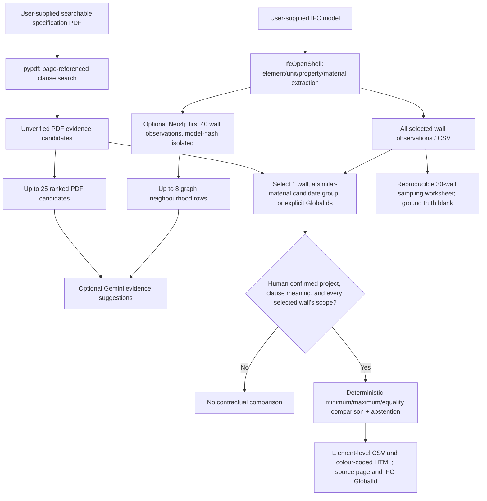

# Wall-first supervisor implementation (28 October 2026)

## Scope and data flow

This branch is based on `original-code-supervisor-fix-2026-10-20`, without changing `main` or the older branch.

## Concrete module responsibilities

| Module | Input | Output | Technical decision |
|---|---|---|---|
| `check_ifc_compliance.py` | IFC path + class selection | Observed wall property evidence, units, material layer total, GlobalIds | IfcOpenShell, no name-based dimension guesses |
| `spec_context.py` | PDF bytes + wall class | Page-indexed candidate excerpts | Searchable PDF, not independent clause verification |
| `ifc_to_neo4j.py` | Model SHA256 + bounded observed walls | Project-isolated model/element/storey/material graph | Bounded Neo4j writes, no global graph deletes |
| `llm_assistance.py` | Ranked PDF extracts + bounded graph context | Candidate clauses with prompt/model metadata | Gemini is a retrieval assistant, not a certifier |
| `wall_focus.py` | Candidate paragraph + selected wall(s) | Confirmed-scope property comparisons | Reject building-height thresholds as wall thickness; explicit human scope gate |
| `audit_engine.py` | Explicit numeric rule + wall observations | PASS, geometry mismatch, missing data, or manual review | Deterministic direction-specific comparisons |
| `validation_export.py`, `validation.py` | Current elements + independently reviewed truth | Sample worksheet and TP/FP/TN/FN metrics | Never populate ground truth automatically |
| `reporting.py` | Audit rows | Printable colour-coded HTML | Status colour is review priority, not life-safety severity |
| `app.py` | Files, user confirmation and optional provider secrets | Interactive dashboard, downloads | Streamlit; separate extraction, candidate retrieval, and comparisons |

## Free-tier-conscious choices

- All selected walls are **extracted locally** (220 in the 28 October test).
- Neo4j receives **at most 40** of those walls. This is a deliberately chosen prototype budget, **not a claimed provider-imposed hard limit**.
- Only **8 graph records** enter the Gemini context and up to **25 selected, ranked PDF excerpts** are supplied per normal LLM call. A/B experiments make additional calls only when explicitly requested.
- Comparison of a reviewer-approved clause with 1 or many walls is **local and deterministic**, requiring zero additional Gemini/Neo4j requests.
- A partial graph does **not** represent all 220 walls; full IFC CSV is the untruncated evidence set.

## Interpreting the current independent test

On 28 October 2026, a separate IFC/PDF pair (different from the professor's pair) produced:
- 220 `IfcWallStandardCase` wall rows with 100 mm declared layer thickness; recorded material `.Alvenaria_Tijolo`.
- 40 observed walls uploaded/retrieved through Neo4j; Gemini returned a candidate-evidence response.
- 220 `NOT_ASSESSABLE` rows in evidence-only mode. This is **not** 220 compliant walls and not 220 violations.
- Zero direct PDF GlobalId/class links. A generic regulatory PDF may be unrelated to the model.
- The earlier app incorrectly offered an **18 m building-height threshold** as an 18,000 mm wall-thickness value. The wall-specific parser now rejects numbers without explicit thickness context.

**No reviewed contractual clause/ground-truth labels have been supplied for this pair.** No real-world compliance accuracy can therefore be reported.

## What a verified, reproducible demonstration must show

1. Confirm the PDF belongs to the IFC project and find the original applicable wall clause.
2. Verify the clause concerns **total wall thickness** (not height, material combustibility, insulation layer, or a table not supplied).
3. Identify whether the condition is exact, a minimum or a maximum; record tolerance if specified.
4. Verify which GlobalIds the clause governs. Selection by material/type is an **aid**, not proof of applicability.
5. Run one wall, then apply to a reviewed set of walls. Export CSV and colour-coded HTML with page and GlobalId.
6. Independently label a 25–30-element sample and calculate TP/FP/TN/FN, noting abstentions and selection bias.
7. Compare A/B prompt outputs on identical IFC/PDF inputs, recording actual model and prompt hashes.
8. Evaluate a second independent IFC/PDF pair. To address the supervisor's mixed-element sampling, later repeat with doors/columns where appropriate; the wall-only sample is intentionally not mixed.

## Safe status semantics

- `PASS` means the **selected verified numeric rule** was satisfied by the model evidence; it does **not** certify the building.
- `GEOMETRY_MISMATCH` indicates disagreement with that rule and should be investigated.
- `MISSING_GEOMETRY` and `MISSING_MATERIAL` are data gaps, not proven physical defects.
- `REVIEW_REQUIRED`, `SCOPE_UNVERIFIED` and `NOT_ASSESSABLE` must not be counted as passes or physical failures.

## Running this branch

Deploy `app.py` from `wall-first-supervisor-2026-10-28`. Continue using existing Streamlit secrets for Gemini and Neo4j, or disable optional modules. Upload IFC and corresponding searchable PDF, leave mode at Evidence extraction only to inspect measurements, then use **Wall thickness clause review — single or batch** after genuine evidence verification. Download reviewer-comparison CSV/HTML. No passwords belong in source control.

Run unit tests using the repository GitHub Actions workflow. Automated tests use simulated IFC/PDF boundaries; **a live Streamlit and true contractual-document test is still required.**
